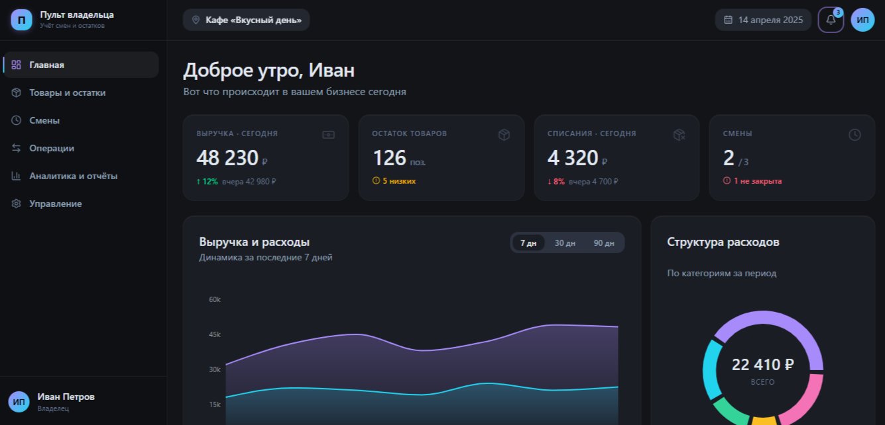
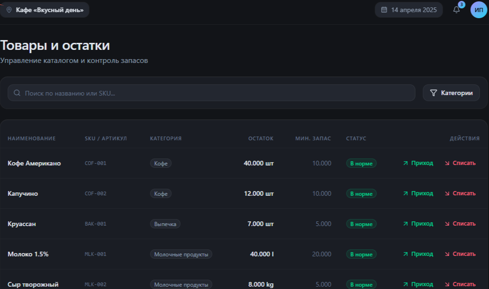
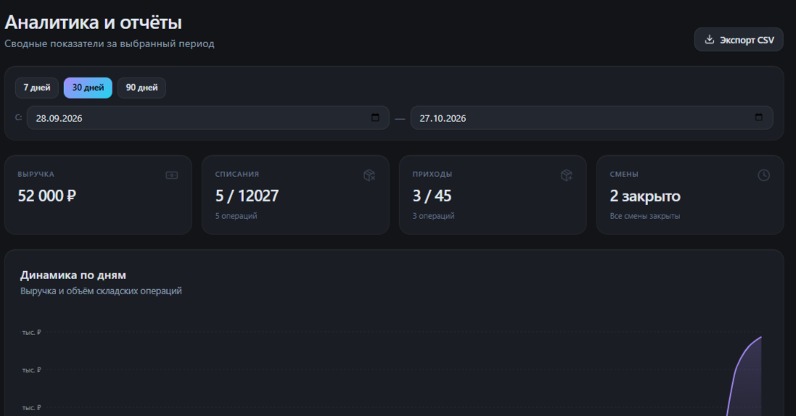
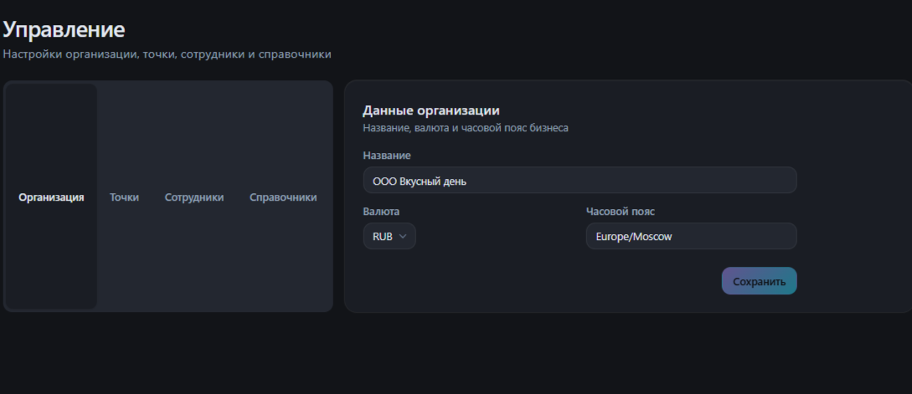

# Пульт владельца 🚀

Адаптивный веб-сервис для автоматизации малого бизнеса (учет смен, остатков и отчетов).

## 🛠 Стек технологий

**Backend:**
- Laravel 12 (PHP 8.2+)
- MySQL (MariaDB)
- Laravel Sanctum (Аутентификация)

**Frontend:**
- Next.js 16 (App Router)
- React 19
- Tailwind CSS v4 + shadcn/ui (Base UI)
- TanStack Query (React Query)
- Recharts (Графики)
- PWA (Progressive Web App)

---

## 📱 Интерфейс приложения

### Дашборд (Главная)
Обзор ключевых метрик, выручки, расходов и последних операций.


### Управление товарами и остатками
Таблица с поиском, статусами остатков и модальными окнами для списания/прихода.


### Аналитика и отчёты
Сводные показатели, графики динамики и экспорт в CSV.


### Настройки и управление
Управление организацией, точками продаж, сотрудниками и справочниками.


---

## 🚀 Как запустить локально

1. Клонируйте репозиторий:
   ```bash
   git clone https://github.com/Sohbet-13/pult-vladelsa.git
   cd pult-vladelsa
